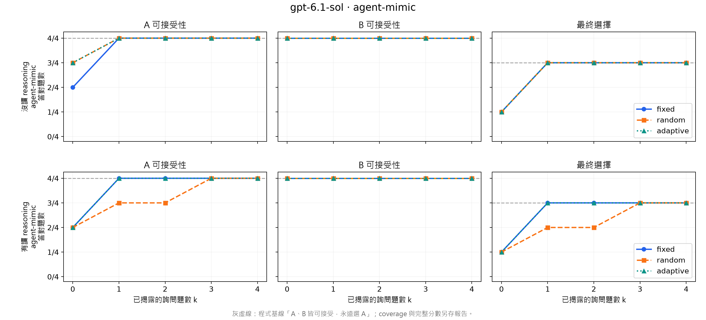

# GPT-6.1 Sol：讀取／不讀取參與者理由

兩組各完成 fixed、random、adaptive，總共 38 筆成功預測／選題。
所有策略在 k=4 都是 A 可接受性 4/4、B 可接受性 4/4、最終選擇 3/4，
所有階段與欄位的 coverage 均為 100%。

讀取理由組的 random 在 k=1–2 為 A 3/4、最終選擇 2/4，k=3 才追平。
這是單次小樣本的觀察，不能推論理由造成退步。k=0 兩條件尚無任何作答／理由可讀，
相同 payload 的獨立預測本身也有差異。最終分數與「兩者皆可接受、永遠選 A」程式基線相同，
因此這次結果尚未顯示超越該簡單基線的個人化預測能力。

Agent model: gpt-6.1-sol; resolved version: unknown.
Reason means the participant reason, not model chain of thought.
Answer snapshot SHA256: cb1f6a8badbc5dd30bda817a3dc7840d53cce34703b9a425120e2fbc1eb8ac88

|Reason access|Strategy|k|A correct/all|B correct/all|Choice correct/all|A/B/choice coverage|
|---|---|---:|---:|---:|---:|---|
|false|fixed|0|2/4|4/4|1/4|1.0/1.0/1.0|
|false|fixed|1|4/4|4/4|3/4|1.0/1.0/1.0|
|false|fixed|2|4/4|4/4|3/4|1.0/1.0/1.0|
|false|fixed|3|4/4|4/4|3/4|1.0/1.0/1.0|
|false|fixed|4|4/4|4/4|3/4|1.0/1.0/1.0|
|false|random|0|3/4|4/4|1/4|1.0/1.0/1.0|
|false|random|1|4/4|4/4|3/4|1.0/1.0/1.0|
|false|random|2|4/4|4/4|3/4|1.0/1.0/1.0|
|false|random|3|4/4|4/4|3/4|1.0/1.0/1.0|
|false|random|4|4/4|4/4|3/4|1.0/1.0/1.0|
|false|adaptive|0|3/4|4/4|1/4|1.0/1.0/1.0|
|false|adaptive|1|4/4|4/4|3/4|1.0/1.0/1.0|
|false|adaptive|2|4/4|4/4|3/4|1.0/1.0/1.0|
|false|adaptive|3|4/4|4/4|3/4|1.0/1.0/1.0|
|false|adaptive|4|4/4|4/4|3/4|1.0/1.0/1.0|
|true|fixed|0|2/4|4/4|1/4|1.0/1.0/1.0|
|true|fixed|1|4/4|4/4|3/4|1.0/1.0/1.0|
|true|fixed|2|4/4|4/4|3/4|1.0/1.0/1.0|
|true|fixed|3|4/4|4/4|3/4|1.0/1.0/1.0|
|true|fixed|4|4/4|4/4|3/4|1.0/1.0/1.0|
|true|random|0|2/4|4/4|1/4|1.0/1.0/1.0|
|true|random|1|3/4|4/4|2/4|1.0/1.0/1.0|
|true|random|2|3/4|4/4|2/4|1.0/1.0/1.0|
|true|random|3|4/4|4/4|3/4|1.0/1.0/1.0|
|true|random|4|4/4|4/4|3/4|1.0/1.0/1.0|
|true|adaptive|0|2/4|4/4|1/4|1.0/1.0/1.0|
|true|adaptive|1|4/4|4/4|3/4|1.0/1.0/1.0|
|true|adaptive|2|4/4|4/4|3/4|1.0/1.0/1.0|
|true|adaptive|3|4/4|4/4|3/4|1.0/1.0/1.0|
|true|adaptive|4|4/4|4/4|3/4|1.0/1.0/1.0|

Gray dashed lines: programmatic baseline, both acceptable / always choose A.
The chart shows correct / labels_available; coverage is reported separately.
Four held-out items from one participant do not establish generalization or a causal reasoning benefit.

`executed-coordinator.py` preserves the exact coordinator source used for these
inference calls and figures; its SHA256 matches `audit.json`. The repository's
current coordinator additionally fixes transport receipt preservation on retries.

The top row excludes participant reasons; the bottom row includes only reasons from revealed queries. The actual agent is GPT-6.1 Sol in both conditions. These are not Gemini API results.

Audit: 38 responses from 38 distinct fresh agent sessions, no tool activity, all payload allowlists checked, and every saved score recomputed from the private frozen answer snapshot.

Transport failures: 1 (model capacity); retried with the same model, no substituted predictions.

Raw participant answers, model-facing requests and raw replies remain private and untracked. Only aggregate outcomes and provenance hashes are published here at the user's explicit request.
